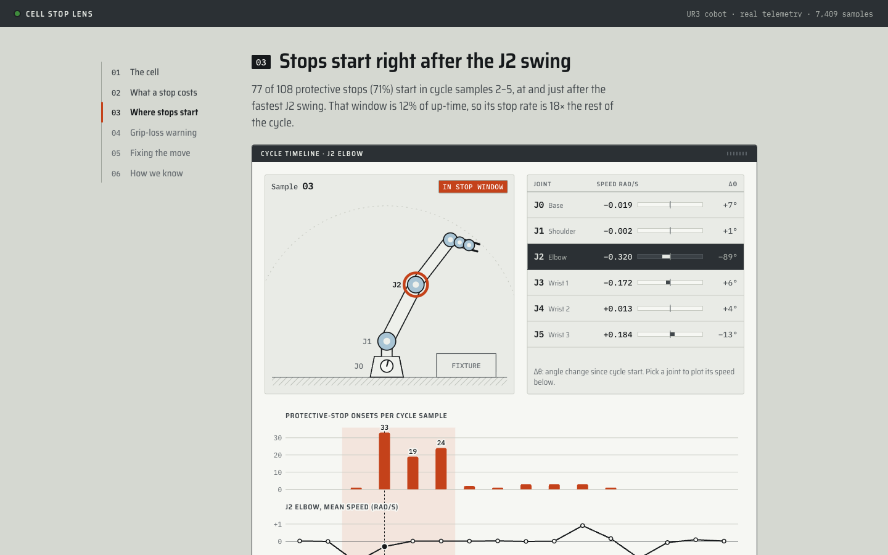
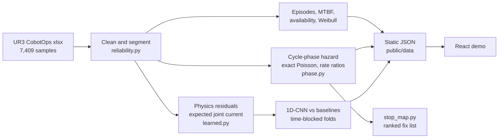

# Cobot Cell Stop Lens

**Find the move in the robot cycle that causes the stops, price each stop, and size the test that proves the fix.** Measured on public telemetry from a real UR3 cobot.

[](tests)
[](LICENSE)
[](https://doi.org/10.24432/C5J891)
[](requirements.txt)
[](pipeline/learned.py)
[](src)

**[Live demo](https://ibiraheel.com/demos/cobot-cell-stop-lens/)** · [METHOD.md](METHOD.md) · [SOLUTION.md](SOLUTION.md)

[](https://ibiraheel.com/demos/cobot-cell-stop-lens/)

---

## Question, answer, solution

**The question.** A robot cell keeps throwing protective stops and dropping parts. Which move in the cycle causes it, what does each stop cost against a contracted uptime target, and what single change should be tested first?

**The answer.** 71 % of protective stops (77 of 108) start in one 4-second window right after the fastest J2 (elbow) swing. That window is 12 % of up-time, so its stop rate is 18x the rest of the cycle. Making that move run at the cycle-average stop rate would remove up to 59 % of stops. Dropped parts cluster later, in transfer and place, and a small 1D-CNN warns of them 3 to 10 s ahead better than the best simple rule. At a 99.6 % uptime target, one 2-minute manual reset uses a whole shift's downtime budget.

**The solution.** A one-page playbook and a CLI, [`pipeline/stop_map.py`](pipeline/stop_map.py). One cell log goes in; a ranked list of moves, the cost of a stop against the uptime budget and the size of the before/after trial come out. [SOLUTION.md](SOLUTION.md) has the decision rules and a week-1 plan for a production line.

## Key results

One UR3, 7,409 samples at about 1 Hz, 2.08 h observed over 3 recording sessions. Brackets are 95 % intervals.

| Result | Value |
| --- | --- |
| Events found | 108 protective stops, 77 grip losses, 184 down episodes |
| Stops in cycle samples 2-5 | 77 of 108 (71 %) in 12 % of up-time · rate ratio **18.1** [11.8, 28.4] |
| Same window, per session | 11.4 [3.4, 43.1] and 24.2 [14.7, 41.2]; the 7-stop session is inconclusive |
| Grip losses in samples 15-30 | 49 of 77 (64 %) in 38 % of up-time · rate ratio 2.9 [1.8, 4.8] |
| MTBF between down episodes | 37.8 s [32.7, 43.9], checked against a hand calculation |
| Rig availability | 92.9 % [91.6, 94.1] |
| Wear-out within the log | none seen: Weibull shape 1.02 [0.92, 1.19] |
| Fix value, J2 window (upper end) | up to 59 % of stops [50 %, 69 %] · 56 to 23 stops per up-hour · availability 92.9 % to 95.1 % |
| Cost of a stop (assumed inputs) | 99.6 % target = 1.92 min per 8 h shift, which fits 0.96 two-minute resets |
| Trial size | 49 baseline stops detect a 50 % drop at 80 % power |

## AI vs baseline

PR-AUC on contiguous time blocks with a purge between train and test, so neighbouring cycles never sit on both sides of a split. Every baseline knows the cycle phase.

| Task | Chance | Best simple baseline | Model | Model minus baseline | Verdict |
| --- | --- | --- | --- | --- | --- |
| Grip loss, 3-10 s ahead | 0.081 | 0.343 (phase + time since last stop and last grip loss) | 1D-CNN **0.549** [0.466, 0.628] | +0.21 [+0.13, +0.29] | **Win** |
| Same, rows with no grip loss in the last 25 s | 0.050 | 0.089 | 1D-CNN **0.318** [0.193, 0.450] | [+0.09, +0.37] | **Win** |
| Protective stop, 10 s ahead | 0.137 | 0.246 (phase + recency) | 1D-CNN 0.272 [0.219, 0.337] | +0.03 [-0.03, +0.09] | **Tie**: no alarm for stops |
| Any down episode, 10 s ahead | 0.232 | 0.332 (phase) | gradient boosting 0.343 | [-0.04, +0.06] | **Tie** once folds keep consecutive cycles together |

The grip-loss result holds with the gripper-current channel removed (0.574) and with strictly causal features (0.567). For stops, knowing where the arm is in its cycle is most of the story, so stops get a fix, not a prediction.

## How it works



- **Reliability.** Episodes are runs of stop or grip-loss rows inside a recording session; time across logging gaps never counts as up-time. MTBF uses a chi-square interval, availability a cycle bootstrap.
- **Where stops start.** Onsets per up-second in each cycle-sample bin, exact Poisson intervals, rate ratios against the rest of the cycle, re-checked per session.
- **Learning.** An inverse-dynamics-style expected-current model per joint (inertia, friction, gravity from integrated joint angles, coupling) is refitted inside each fold. Its residuals, joint speeds, temperatures and tool current feed a small 1D-CNN that reads the last 12 s across 25 channels.
- **No live services.** The pipeline writes JSON once; the demo reads static files and needs no API keys.

Equations, assumptions and every validation check are in [METHOD.md](METHOD.md).

## Quickstart

```bash
# Python pipeline (3.11, CPU PyTorch)
python3.11 -m venv .venv && .venv/bin/pip install -r requirements.txt
mkdir -p downloads && curl -L -o downloads/ur3.zip "https://archive.ics.uci.edu/static/public/963/ur3+cobotops.zip" && unzip -o downloads/ur3.zip -d downloads

OMP_NUM_THREADS=2 .venv/bin/python -I pipeline/run.py downloads/dataset_02052023.xlsx public/data
OMP_NUM_THREADS=3 .venv/bin/python -I pipeline/run_learned.py downloads/dataset_02052023.xlsx public/data    # about 7 min on 3 threads
OMP_NUM_THREADS=3 .venv/bin/python -I pipeline/check_leakage.py downloads/dataset_02052023.xlsx public/data

# Tests (36)
.venv/bin/python -I -m pytest -q tests

# The stop-map tool
OMP_NUM_THREADS=3 .venv/bin/python -I pipeline/stop_map.py downloads/dataset_02052023.xlsx --window 2-5 --grip-window 15-30
OMP_NUM_THREADS=3 .venv/bin/python -I pipeline/stop_map.py cell_log.xlsx --recovery-s 120 --case-rate 12 --shift-h 8 --target 0.996 --json out.json

# Demo
npm install
npm run dev        # open http://localhost:5173/demos/cobot-cell-stop-lens/
npm run build      # static site in dist/, built for the /demos/cobot-cell-stop-lens/ path
npm run preview
```

The precomputed JSON is committed in `public/data/`, so the demo runs without the Python steps.

## Repo layout

```
pipeline/
  reliability.py     cleaning, sessions, episodes, MTBF, availability, Weibull
  phase.py           cycle-phase hazard, rate ratios, power calculation
  warning.py         per-joint load models, gradient-boosted baseline study
  learned.py         physics residual model, 1D-CNN, blocked folds
  run.py             main pipeline -> public/data/*.json
  run_learned.py     learned-model study -> public/data/learned.json
  check_leakage.py   causal-feature and grip-aware baseline checks
  throughput.py      cost per stop against an uptime budget
  stop_map.py        the stop-map CLI
tests/               36 pytest tests: hand calculations, known values, leakage checks
public/data/         precomputed results read by the demo
src/                 React + TypeScript demo
METHOD.md            equations, assumptions, validation
SOLUTION.md          playbook, decision rules, week-1 plan
```

## Data

**UR3 CobotOps.** Tyrovolas, M., Aliev, K., Antonelli, D., Stylios, C. (2024). UCI Machine Learning Repository. [doi:10.24432/C5J891](https://doi.org/10.24432/C5J891). Licensed [CC BY 4.0](https://creativecommons.org/licenses/by/4.0/).

All results come from this real telemetry; no synthetic data. Case rate, shift length, recovery time and the 99.6 % target in the cost step are inputs, not measurements.

## Limitations

- One robot and 2.08 h of data. The UR3 is a pick-and-place test cobot, not a production palletizer.
- The samples 2-5 window was picked on the same data it is scored on, so the 18x and the 59 % fix value lean high. One session holds 81 % of the stops, and the window has not been tested on an untouched recording or cell.
- At 1 Hz with no joint positions in the log, sub-second transients are hidden and a stop can be tied to a cycle sample but not to a named waypoint.
- The grip-loss warning is a lead to confirm on a real cell, not a validated alarm: 77 events, and part of its signal is that grip losses come in runs.
- The CNN settings were fixed by hand with no separate tuning split.

## License

Code: [MIT](LICENSE). Data: CC BY 4.0, credited above.

---

**Ibi Raheel** · mechanical engineer building AI tools · [ibiraheel.com](https://ibiraheel.com)
